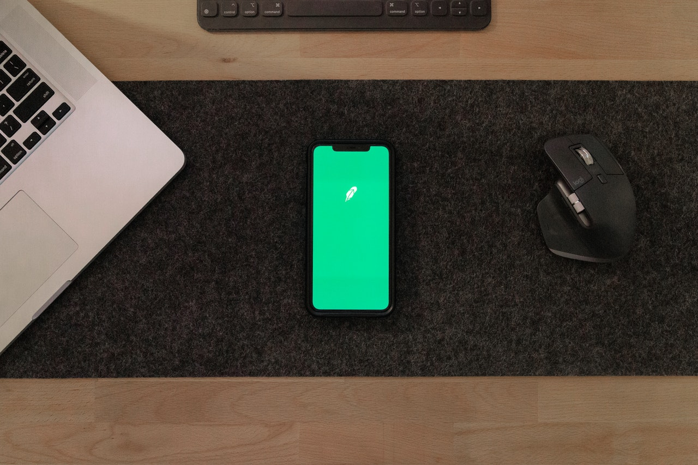

> :warning: ¡Importantísimo! Si no te familiarizas con el contenido
> de este repositorio (el README, el enunciado, los roles, etc.), no
> podremos calificarte, y la puntuación será de **cero**. Tómate un
> tiempo para leerlo todo con calma.
>
> - Leer un resumen de este README no equivale a conocer su contenido.
>
> - No conocer el contenido de este README califica como **cero**.


# Curso 26/27. Práctica 2. Interfaces gráficas para aplicaciones en dispositivos móviles



_Repositorio dedicado al desarrollo de la segunda práctica de equipo
de IPM_

Este repositorio contiene todo el material necesario para comenzar el
desarrollo de la práctica.


En este trabajo práctico, debes diseñar e implementar una aplicación
para dispositivos móviles con su correspondiente _IGU_, _interfaz
gráfica de usuaria_.

Este documento:

  - describe el trabajo a realizar
  
  - establece los roles a desempeñar por parte de los miembros del equipo
  
  - describe los resultados (entregas) de la práctica
  
  - proporciona las rúbricas necesarias para la autoevaluación
  
  - proporciona indicaciones y sugerencias para validar el trabajo realizado


> ⚠️ Evaluación ⚠️ Este documento incluye atributos de calidad, rúbricas
> y una lista de los errores más comunes. Úsalos para auto-evaluar tu
> trabajo y corregir las deficiencias antes de la revisión del
> profesor. La valoración de tu trabajo será pobre si presenta alguna
> de las deficiencias que ya están descritas en este documento.


---


# Equipo de trabajo

El equipo de trabajo está formado por tres personas. Cada persona
desempeñará un rol individual durante el desarrollo de la práctica.

La descripción de cada rol y sus requisitos de asignación se
encuentran en el fichero [roles.md](roles.md).

Una vez asignados los roles de cada miembro del equipo, debéis cubrir
el fichero [AUTHORS](AUTHORS) siguiendo el formato de ejemplo del
propio fichero.


---


# Presentación de la aplicación (IPMSportsFan)

En esta práctica el aspecto clave de la aplicación es la interfaz
gráfica de usuaria en un dispositivo móvil.

_IPMSportsFan_ es una aplicación para dispositivos móviles que permite
consultar los resultados de diversos eventos deportivos garantizando
una experiencia de usuario satisfactoria, fluida y sin bloqueos.


# Objetivos de aprendizaje

En el desarrollo de software profesional, la construcción de
interfaces gráficas de usuario (GUI) requiere una separación estricta
entre la lógica de negocio y la presentación. Asimismo, las
aplicaciones modernas deben adaptarse a las múltiples configuraciones
de los dispositivos móviles. Por último, pero no menos importante, el
_aseguramiento de la calidad_ precisa del desarrollo de pruebas
automatizadas que validen el funcionamiento correcto de la aplicación.

Realizando este trabajo de forma correcta demuestras ser capaz de:

  - __separar la vista y el modelo__ desde el diseño de la
    arquitectura de la aplicación hasta la implementación.
  
  - entender por qué es necesario que el diseño de la interfaz sea
    adaptativo.
	
  - entender las distintas condiciones que debe resolver la adaptación
    de la interfaz.
	
  - implementar un diseño adaptativo.
	
  - entender la necesidad de las pruebas automatizadas para el
    aseguramiento de la calidad.

  - implementar pruebas automatizadas que ejerciten la aplicación a
    través de la interfaz gráfica, tal y como haría la usuaria.


## Mini-proyecto

La práctica abarca el desarrollo completo de una aplicación. Esto incluye:

  - QA.
  
    Pruebas, documentación, planificación, seguimiento, control de versiones.
	
  - Análisis de requisitos.
  
  - Análisis y diseño del software.
  
  - Implementación.
  
  
---

# Descripción: Consulta de resultados deportivos (IPMSportsFan)

Esta es una aplicación típica para dispositivos móviles que demuestra la
adaptación de la interfaz.

- **¿En qué consiste?** Una aplicación donde la usuaria puede
  consultar la información de sus eventos deportivos favoritos. La
  aplicación recupera la información de uno o varios servidores.

- **Cómo cubre los objetivos:**

  * **Arquitectura de la aplicación:** La arquitectura diseñada debe
    separar la interfaz del manejo de las peticiones al servidor.
  
  * **Adaptación:** La interfaz se debe adaptar a la configuración del
    dispositivo móvil: tamaño de pantalla, resolución, orientación,
    tipo de dispositivo (teléfono vs. tablet), etc.
  
  * **QA:** Desarrollo de pruebas automatizadas a través de la
    interfaz de usuaria.


## División en tareas

De cara a la evaluación continua, la práctica se divide en tres tareas.


  - __Tarea 1__
  
    * Hito 1: Arquitectura Base y Diseño de la Interfaz.
	
      1. Analiza los casos de uso relevantes para la aplicación.
	  
	  2. Realiza el diseño de una interfaz adaptativa para la
         aplicación.
	  
	  3. Escoge un patrón arquitectónico que separe la vista del
         modelo y que sea adecuado para su implementación en una
         aplicación basada en _Flutter_.
		 
	  4. Desarrolla el diseño software de la aplicación aplicando el
         patrón seleccionado en el paso anterior.
	
  - __Tarea 2__
  
    * Hito 2: Desarrollo de la aplicación.
	
	  Escribe el código de la aplicación siguiendo el diseño que
      realizaste en la tarea anterior.
	
	
  - __Tarea 3__
  
    * Hito 3: Tests end2end.
	
	  Usando las librerías de testing de Flutter implementa pruebas de
      tipo _end to end_ para validar tanto los casos de uso de la
      aplicación como la gestión de errores de la aplicación.
	  
  
     > *warning:* No confudir las pruebas de widgets (`testWidgets`)
     > con las pruebas de integración (`integration_test`). Esta tarea
     > precisa de estas últimas.
	 
---


## Requisitos tecnológicos

1. La librería para construir la interfaz gráfica es _Flutter_.
  
   La aplicación debe ser funcional en android y/o ios.
   
2. El control de versiones se realiza con _Git_.

3. Se guardará una copia completa del repositorio en _GitHub_. Los
   docentes tendrán acceso a dicho repositorio.

4. La aplicación debe funcionar con un servidor real. Las pruebas se
   deben hacer contra un servidor simulado.
   
   La elección del servidor es libre. Se puede obtener ayuda al
   respecto en este documento que detalla algunas [propuestas de
   servidores](servers.md).

   

## Requisitos Funcionales (RF)

La interfaz de la aplicación debe resolver los siguientes requisitos:


- __RF-1:__ Consulta y Listado de Eventos.

  La aplicación debe mostrar un listado actualizado de eventos
  deportivos (rugby, fútbol, baloncesto, hockey línea, tenis, etc.)
  obtenidos desde el servidor/API.


- __RF-2:__ Detalle del Evento Deportivo.

  Al seleccionar un evento la interfaz debe navegar a una
  pantalla/componente de detalle que muestre la información
  ampliada. P.e.: alineaciones, estadísticas en directo, marcador
  detallado y cronología.

  
- __RF-3:__ Filtrado y Búsqueda.

  La interfaz debe permitir filtrar los eventos por deporte, estado
  (en directo, finalizados, próximos) o mediante un buscador por
  texto.


- __RF-4:__ Gestión de errores.

  La aplicación gestiona los errores sin que la interfaz sufra
  bloqueos o cierres inesperados y la usuaria recibe un feedback
  adecuado y útil en cada caso. P.e.: Si falla la conexión con el
  servidor, la aplicación muestra un estado visual claro
  (pantalla vacía con botón de reintentar o banner de error).


- __RF-5:__ Gestión de Favoritos.

  La usuaria debe poder marcar/desmarcar eventos o equipos como
  favoritos, persistiendo esta selección localmente en el dispositivo.
  
  
---


## Requisitos Técnicos y Restricciones (Atributos de Calidad)


- **T1.** Tecnología base: Desarrollo obligatorio en Flutter (versión
  estable actual) utilizando el lenguaje Dart. Compatible con Android
  e iOS.

- **T2.** Interfaz Adaptativa (Responsive Design): La interfaz debe
  adaptarse de forma fluida a diferentes factores de forma
  (smartphones y tablets) y orientaciones (retrato y apaisado),
  reorganizando los componentes (por ejemplo, diseño de panel
  maestro-detalle en tablets).

- **T3.** Separación de Responsabilidades (Arquitectura): Se debe
  aplicar un patrón arquitectónico limpio que separe estrictamente la
  vista de la lógica de negocio y de la capa de red y sea adecuado
  para su aplicación en Flutter (ej. BLoC/Cubit, Riverpod o Provider
  combinados con repositorios de datos). Queda prohibido mezclar
  llamadas HTTP o lógica de negocio directamente dentro de los métodos
  build de los widgets.

- **T4.** Control de Calidad del Código: El código debe superar el
  analizador estático (Flutter analyze) sin warnings críticos y
  mantener una estructura modular limpia.

---


## Documentación técnica

1. _Diseño de la interfaz de usuaria_. Tiene que seguir
   las mismas pautas que siguió en las prácticas anteriores
   (shorthand + wireframes).

2. _Adaptabilidad_ (1/2). Breve descripción de las pautas seguidas
   para diseñar la adpatabilidad de la interfaz.

3. _Adaptabilidad_ (2/2). Matriz de capturas de pantalla que muestra
   el comportamiento adaptativo de la aplicación.

4. _Diseño arquitectónico de la aplicación_. Usando el lenguaje de
   modelado C4 o UML.
   
5. _Diseño software_. Usando obligatoriamente el lenguaje UML para
   documentar el diseño. No se permite usar ningún otro lenguaje de
   diagramado.
   
6. _QA_: Breve explicación de la estrategia de pruebas.
   

### 📷 Evidencias Gráficas de Adaptabilidad (Capturas de pantalla)


Configuraciones requeridas para las capturas:

  1. Smartphone (Retrato / Portrait): Vista principal (Listado de
     eventos) y vista de detalle en pantalla de teléfono estándar
     (ej. `1080 x 1920`).
  
  2. Smartphone (Apaisado / Landscape): Mismas pantallas en modo
     apaisado, comprobando que la interfaz no genere errores de
     desbordamiento (Overflow Yellow/Black Bars).
  
  3. Tablet o Pantalla Grande (Retrato o Apaisado): Demostración de la
     adaptación de la interfaz a pantallas grandes (ej. diseño de
     doble panel / Master-Detail).
  
  4. Estado de Carga / Error de Red: Captura de la interfaz
     reaccionando visualmente cuando no hay datos o la conexión falla.


## Resultados

Todos los recursos entregables deben encontrarse en el repositorio
designado. El repositorio debe estar convenientemente estructurado y
contener:

  - Código fuente completo. Proyecto limpio y compilable/ejecutable
    sin errores.

  - Documentación técnica. Documentación descrita en el apartado
    anterior.


## Evaluación

- **Arquitectura y Diseño Adaptativo (30%):** Correcta separación
  vista-modelo, diseño adaptativo para diferentes pantallas y
  aplicación de principios de usabilidad.

- **Implementación en Flutter y Funcionalidad (35%):** Funcionamiento
  fluido de IPMSportsFan, consumo correcto de datos, ausencia de
  bloqueos y gestión de errores.

- **Pruebas Automatizadas End-to-End (20%):** Cobertura y correcta
  implementación de los tests E2E mediante las librerías de Flutter.

- **Documentación y Trabajo en Equipo (15%):** Calidad de la memoria
  técnica, uso riguroso de Git y cumplimiento de roles.


---


# Errores típicos

A continuación se detallan algunos errores típicos que se cometen de
forma recurrente divididos por los objetivos de la práctica:


1. Gestión incorrecta de errores: Captura silenciosa de excepciones,
   ausencia de feedback.
   
2. Feedback incorrecto: falta de indicadores,
   p.e. `CircularProgressIndicator`durante operaciones pesadas.
   
3. Diseños no adaptativos: P.e.: utilizar anchos y altos absolutos en
   píxeles (width: 400) provocando desbordamientos (overflow errors)
   en pantallas más pequeñas. P.e.: no aprovechar las capacidades de
   algunos dispositivos (tablets).

4. Tests E2E frágiles: Escribir pruebas dependientes de tiempos de
   espera fijos (`Future.delayed`) en lugar de usar las herramientas
   de sincronización nativas de Flutter Driver o
   integration_test. Escribir pruebas dependientes de una estructura
   concreta del árbol de widgets, p.e. recuperar el segundo hijo de un
   widget.
   
5. Bucles infinitos en el test E2E. `pumpAndSettle` puede no
   sincronizarse adecuadamente con las funciones asíncronas.


# 📊 Rúbrica detallada de evaluación


| Criterio | Excelente (10-9) | Notable (8-7) | Aprobado (6-5) | Suspenso (<5) |
| --- | --- | --- | --- | --- |
| **Arquitectura y Adaptabilidad** | Separación estricta de capas (Modelo-Vista). La interfaz se adapta de forma impecable y fluida a smartphones y tablets en cualquier orientación. | Buena arquitectura limpia y diseño adaptativo correcto con limitaciones menores en algún factor de forma. | Arquitectura funcional pero con cierto acoplamiento; adaptación rígida o con fallos menores de responsividad. | Código monolítico sin separación de capas; la interfaz se rompe por completo al cambiar de tamaño u orientación. |
| **Implementación en Flutter y Funcionalidad** | Aplicación robusta, fluida, excelente gestión de estados, carga y errores de red en *IPMSportsFan*. | Aplicación plenamente funcional que cumple con los requisitos principales de consulta de resultados y navegación. | Funcionalidad parcial, con pequeños bugs de interfaz, o gestión deficiente de la conectividad y estados vacíos. | Aplicación no funcional, con errores graves de compilación, cuelgues constantes o ausencia de Flutter. |
| **Pruebas End-to-End (E2E) y Calidad** | Pruebas E2E completas y automatizadas que cubren con éxito los flujos principales, casos borde y gestión de errores. | Pruebas E2E implementadas que cubren correctamente los casos de uso principales de la aplicación. | Pruebas básicas, frágiles o incompletas que apenas ejercitan la interfaz de usuario. | Ausencia total de pruebas automatizadas o tests que fallan al compilar. |
| **Documentación y Evidencias (Memoria)** | Memoria excelente, análisis profundo, justificación sólida y matriz completa de capturas en diversas configuraciones (móvil, tablet, nube). | Memoria completa con todos los apartados requeridos y evidencias gráficas correctas. | Memoria justa, descripciones superficiales y capturas incompletas o de una única configuración. | Memoria ausente, incompleta, sin evidencias gráficas o con indicios claros de plagio. |


## ⚠️ Pauta de conversión para la nota final ⚠️

Para obtener el aprobado de la práctica, es __requisito
indispensable__ ninguno de los apartados que conforman la rúbrica
puede calificar como _suspenso_.


---

# Entorno para la corrección

El repositorio deberá incluir en el README.md una sección de instrucciones de ejecución:

  1. Comando de dependencias: `flutter pub get`

  2. Ejecución de la app: Flutter run indicando el dispositivo
     (emulador Android, simulador iOS, ...).

  3. Ejecución de pruebas E2E: Instrucciones para lanzar los tests de
     integración (`flutter test integration_test/app_test.dart`).

  4. Checklist rápido para el corrector:

     - Comprobar el comportamiento al girar el dispositivo en la
       pantalla de listado de eventos deportivos.

     - Simular la desconexión de red para comprobar el manejo de
       errores.


# 🔍 Guía de Pruebas Exploratorias

Las pruebas exploratorias complementan a las pruebas automatizadas
(E2E), permitiendo evaluar la experiencia de usuario real, la fluidez
visual y los casos borde que un script automatizado difícilmente puede
juzgar con criterio humano.


## Bloque 1: Adaptabilidad y Comportamiento Adaptativo

* **Rotación de pantalla dinámica:**

  * *Acción:* Girar el dispositivo o emulador entre el modo retrato
    (*portrait*) y apaisado (*landscape*) en todas las pantallas
    principales.

  * *Criterio de éxito:* La interfaz se reorganiza sin generar errores
    de desbordamiento (*overflows*) y aprovecha el espacio horizontal
    adicional (por ejemplo, mostrando una vista de panel dual en
    tablets o pantallas anchas).


* **Escalado de fuentes del sistema:**

  * *Acción:* Cambiar la configuración de accesibilidad del sistema
    operativo para aumentar el tamaño del texto.
	
  * *Criterio de éxito:* Los textos se adaptan correctamente sin
    solaparse con iconos o recortarse en los botones principales.


### Bloque 2: Usabilidad e Interacción (Heurísticas de Nielsen)

* **Feedback visual inmediato:**

  * *Acción:* Pulsar sobre botones de acción crítica (ej. recargar
    listado, marcar favorito, enviar datos).

  * *Criterio de éxito:* La interfaz muestra de forma instantánea un
    indicador de carga (p.e. `CircularProgressIndicator`) o una transición
    fluida, evitando la sensación de bloqueo en la aplicación.


* **Prevención de errores y estados vacíos:**

  * *Acción:* Navegar a secciones sin datos o donde la búsqueda no
    devuelva resultados.
	
  * *Criterio de éxito:* Se muestra un estado vacío amigable (*empty
    state*) con una ilustración o texto descriptivo y una acción clara
    para el usuario, en lugar de una pantalla en blanco o un error
    crítico.


### Bloque 3: Resiliencia y Manejo de Conectividad

* **Simulación de red lenta o nula:**

  * *Acción:* Activar el modo avión o limitar la velocidad de red en
    las herramientas de desarrollo de Flutter (`Network Throttling` /
    Modo Offline) mientras se consulta el listado de eventos
    deportivos.
	
  * *Criterio de éxito:* La aplicación gestiona la excepción de red de
    manera elegante, mostrando un banner de aviso o un botón de
    reintentar (*Retry*) sin cerrar la aplicación de forma abrupta
    (*crash*).


---

# 🛠️ Entorno y Protocolo para la Corrección

Para garantizar que el profesorado pueda compilar, probar y corregir
la práctica en pocos minutos sin fricciones técnicas, el repositorio
debe incluir en el `README.md` las siguientes especificaciones:

## 1. Requisitos del Entorno de Desarrollo

* **Versión de Flutter:**
* **Dependencias externas:**


## 2. Comandos de Verificación Rápida

El profesor o corrector ejecutará secuencialmente los siguientes
comandos desde la raíz del proyecto:

```bash
# 1. Obtener dependencias del proyecto
flutter pub get

# 2. Ejecutar el análisis estático de código (debe pasar sin warnings críticos)
flutter analyze

# 3. Lanzar las pruebas automatizadas (Unitarias + E2E)
flutter test
flutter test integration_test

```

## 3. Checklist del Corrector

1. **Puesta en marcha:** Compilación exitosa en emulador Android o
   simulador iOS mediante `flutter run`.

2. **Exploración libre:** Navegación por el flujo principal de
   *IPMSportsFan*. (Listado, Detalle del evento, Favoritos).

3. **Verificación de arquitectura:** Inspección visual rápida del
   código para comprobar la separación de responsabilidades y el uso
   adecuado del patrón arquitectónico.

4. **Validación de tests:** Comprobación de que los tests E2E
   descritos en el hito correspondiente se ejecutan y validan
   correctamente.

---


# Apoyo Técnico

## Automatización de capturas de pantalla


Para evitar las capturas manuales, se sugieren dos alternativas
técnicas sencillas de implementar en Flutter.

### Opción A: Automatización de capturas mediante Integration Tests

Aprovechando que en el **Hito 3** se implementan las pruebas
End-to-End (E2E), se pueden añadir a los tests de Flutter la
generación automática de capturas usando `binding.takeScreenshot()`.

#### Ejemplo de script de prueba para capturas automáticas:

```dart
// integration_test/screenshots_test.dart
import 'package:flutter_test/flutter_test.dart';
import 'package:integration_test/integration_test.dart';
import 'package:ipmsportsfan/main.dart' as app;

void main() {
  final IntegrationTestWidgetsFlutterBinding binding =
      IntegrationTestWidgetsFlutterBinding.ensureInitialized();

  testWidgets('Generar capturas de pantalla para la memoria', (WidgetTester tester) async {
    // 1. Inicializar la app
    app.main();
    await tester.pumpAndSettle();

    // 2. Captura 1: Pantalla Principal (Listado)
    await binding.takeScreenshot('01_listado_eventos');

    // 3. Interactuar: Pulsar sobre el primer evento
    final Finder primerEvento = find.byKey(const Key('evento_item_0'));
    await tester.tap(primerEvento);
    await tester.pumpAndSettle();

    // 4. Captura 2: Pantalla Detalle
    await binding.takeScreenshot('02_detalle_evento');
  });
}

```

> **Tip:** Puedes ejecutar este test cambiando la
> resolución/orientación del emulador o usando emuladores con
> distintos factores de forma (Teléfono vs. Tablet) para generar
> automáticamente todas las capturas del documento.


> **Warning** Este mismo test se vuelve frágil si en el paso 3 estamos
> buscando un elemento que se crea de forma dinámica, por ejemplo en
> un lista `ListView.builder`.


### Opción B: Captura rápida mediante CLI de Flutter / Android

Si prefieres, puedes usar comandos de consola directamente vinculados
al dispositivo en ejecución:

- Mediante la CLI de Flutter (con la app en ejecución): `flutter
  screenshot`.

- Mediante comandos de terminal de Android/iOS:

```bash
# Captura directa en Android desde la terminal:
adb exec-out screencap -p > capturas/smartphone_portrait.png

```


## Herramienta externas

El paquete de Flutter `device_preview` permite simular dentro de la
propia aplicación cómo se ve en un iPhone, un teléfono Android
pequeño, una tablet o en orientación apaisada, e incluye una opción
nativa para tomar capturas de pantalla.

```dart
// main.dart (solo en entorno de desarrollo/diseño)
import 'package:device_preview/device_preview.dart';
import 'package:flutter/material.dart';

void main() => runApp(
  DevicePreview(
    enabled: true, // Cambiar a false en entrega final
    builder: (context) => const IPMSportsFanApp(),
  ),
);

```


---
# Apoyo al diseño

Este apartado propone tres _perfiles de usuario_ (_personas_) para la
aplicación _IPMSportsFan_. Estos perfiles pueden usarse como soporte
para identificar una versión inicial de los casos de uso.

Esta lista no es, ni mucho menos, definitiva, durante el proceso de
análisis se pueden identificar otros perfiles. En tal caso, se
recomienda documentar los perfiles adicionales siguiendo la misma
plantilla.


  1. Carlos, el "Forofo" Multitarea (Uso en Movilidad)

    * **Perfil:** 28 años, analista de datos. Fanático del fútbol y el baloncesto.
	
    * **Contexto de uso:** Consulta los resultados rápidamente
      mientras va en el metro o camina hacia el trabajo, muchas veces
      con una sola mano y con conexión de red inestable.
	
    * **Necesidades clave para la interfaz:**
      - Acceso inmediato a los partidos **en directo** sin navegación
        compleja.
      - Tiempos de carga rápidos y feedback visual claro cuando la red
        falla o va lenta.
      - Botones y áreas táctiles grandes para poder pulsar fácilmente
        en movimiento.


  2. Lucía, la Aficionada Ocasional (Filtrado y Organización)

    * **Perfil:** 42 años, profesora. Le gusta seguir los grandes
      eventos deportivos del fin de semana (tenis, Fórmula 1 y
      fútbol), pero no sigue el día a día.
	
    * **Contexto de uso:** Se sienta en el sofá con su teléfono el
      domingo por la tarde para ponerse al día de los resultados de
      sus deportistas favoritos.
	
    * **Necesidades clave para la interfaz:**
      - Un sistema de **búsqueda y filtrado** intuitivo (por deporte,
        fecha o estado del evento).
      - Una pantalla de detalle limpia que muestre estadísticas claras
        sin saturación visual.
      - Capacidad de marcar eventos como **favoritos** para
        encontrarlos rápido.


  3. Mateo, el Aficionado Senior (Accesibilidad y Pantallas Grandes)

    * **Perfil:** 64 años, jubilado. Le encanta seguir la liga de
      fútbol local. Debido a problemas de vista leves, prefiere usar
      una tablet en lugar del móvil.
	
    * **Contexto de uso:** Consulta la aplicación en casa con la
      tablet apoyada en la mesa o en orientación horizontal
      (*landscape*).
	
    * **Necesidades clave para la interfaz:**
      - **Diseño adaptativo real:** Que la app aproveche el espacio de
        la tablet (ej. vista de panel dual: listado a la izquierda,
        detalle a la derecha).
      - **Accesibilidad (a11y):** Contraste de colores adecuado y
        compatibilidad con el escalado de fuentes del sistema
        operativo.
      - Textos claros y descriptivos, evitando iconos sin etiquetas
        explicativas.


Estos perfiles también son la base para aportar valor al
diseño de la interfaz:

  - __Carlos__: Obliga a optimizar los flujos críticos de navegación y a
    gestionar los estados de error de red.

  - __Lucía__: Justifica la implementación de la jerarquía visual, las
    listas filtrables y la persistencia local de datos (favoritos).

  - __Mateo__: Obliga a evaluar la adaptabilidad responsiva de
    Flutter.


Por último, estos perfiles también puede guiar el diseño de las
pruebas end2end si consideramos el desarrollo de pruebas que cubran
las necesidades clave de cada perfil.


---

# Uso de sistemas de inteligencia artificial

Se puede consultar la normativa de la Universidade da Coruña sobre el
uso de sistemas de inteligencia artificial en la actividad académica
en el siguiente enlace:

https://www.udc.gal/export/sites/udc/goberno/_galeria_down/secretaria/documentos/informacionpublica/Normativa_UDC_usos_academicos_IA.pdf_2063069294.pdf

También disponible:

https://www.udc.gal/es/goberno/equipo_reitoral/secretaria/informacion-publica/
